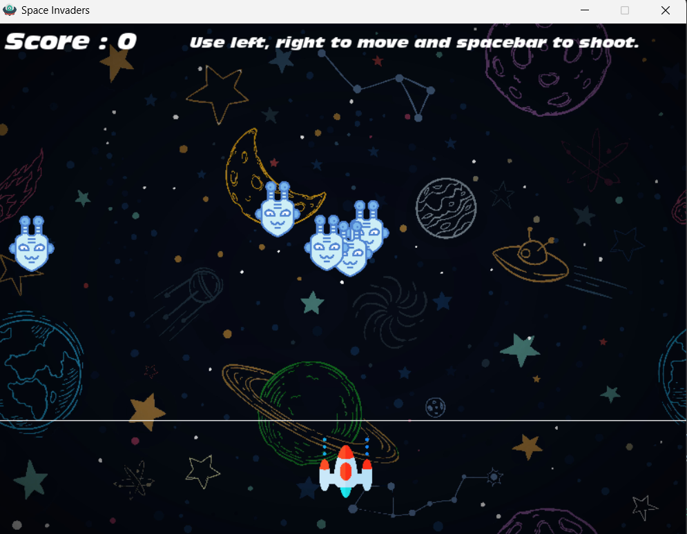

# 🚀 Space Invaders

A simple and fun remake of the classic **Space Invaders** arcade game using **Python** and **Pygame**.

---

## 🎮 Gameplay Instructions

- **Move the spaceship** using:

  - `←` Left Arrow
  - `→` Right Arrow

- **Shoot bullets** with the `Spacebar`
- Hit enemies to:

  - Increase your **score**
  - Increase the **speed** of the enemy you hit

- **Game Over** if any enemy crosses the **white line**

---

## 🕹 Features

- Custom graphics for spaceship, enemies, and bullets
- Sound effects for background, firing, and explosions
- Increasing difficulty with every hit
- Collision detection and scoring
- Game over animation and display

---

## 🚀 Run the Game

### 🧰 Requirements

- Python 3.x
- Pygame (auto-installed by script)

### ▶️ How to Run

```bash
python main.py
```

> The game will automatically install `pygame` if not already installed.

---

## 📸 Preview



---
